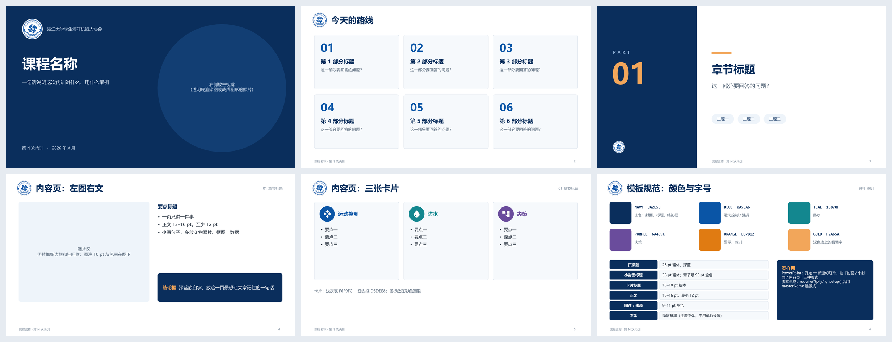

# ZJUOC 内训 PPT 模板

浙江大学学生海洋机器人协会内训用的 PPT 模板：三种版式（封面、小封面、内容页），统一的配色和字号，再加一套用 [pptxgenjs](https://github.com/gitbrent/PptxGenJS) 写课件的绘图 helper。第一次内训《水下机器人导论》就是用它生成的。



## 直接用 PowerPoint

下载 [`dist/内训PPT模板.potx`](dist/内训PPT模板.potx)，双击打开会以它为模板新建一份演示文稿。在“开始 → 新建幻灯片”里选三种版式：

| 版式 | 用途 | 占位符 |
| --- | --- | --- |
| 封面 | 第一页 | 标题、副标题、日期 |
| 小封面 | 每个部分的章节页 | 章节号、标题、引导问题 |
| 内容页 | 正文 | 标题；页脚和页码自动带上 |

[`dist/内训PPT模板.pptx`](dist/内训PPT模板.pptx) 是同样内容的普通演示文稿，里面有目录页、图文页、卡片页的示例和一页规范说明。

## 用脚本生成课件

需要 Node.js 20.9 或更高版本。

```bash
npm install
npm run build        # 重新生成 dist/ 里的 .pptx 和 .potx
```

在自己的脚本里：

```js
const pptxgen = require("pptxgenjs");
const tpl = require("./tpl");

(async () => {
  const pres = new pptxgen();
  const { C, T, box, header } = await tpl.setup(pres, { footer: "课程名称 · 第 N 次内训" });

  const s = pres.addSlide({ masterName: "内容页" });
  header(s, "页面标题", "01 章节名");
  T(s, "正文", { x: 0.6, y: 1.3, w: 6, h: 1, fontSize: 16 });
  box(s, 0.6, 2.6, 6, 1, "结论框", { fill: C.NAVY, color: "FFFFFF" });

  await tpl.finish(pres, "输出.pptx");
})();
```

`setup(pres, opt)` 的选项：

- `footer`：内容页和小封面左下角的页脚文字。
- `fontBump`：设为 `true` 时，24 pt 以下的字整体加大 2 pt（10 pt 及以下加 1.5 pt），适合在大教室投影。

`setup()` 返回的 helper：

| helper | 作用 |
| --- | --- |
| `T(slide, text, opts)` | 文本框，默认微软雅黑、无边距 |
| `box(slide, x, y, w, h, text, opts)` | 带底色的圆角文字框 |
| `card(slide, x, y, w, h)` | 浅灰底、细边框的卡片 |
| `arrow(slide, x1, y1, x2, y2, opts)` | 箭头或连线 |
| `photo(slide, file, x, y, w, h, caption)` | 照片：裁切、细边框、轻阴影，图注写在下方 |
| `render(slide, file, x, y, w, h, anchors)` | 透明底渲染图：裁掉空白后放进框里，返回锚点在页面上的坐标，方便画标注线 |
| `iconCircle(slide, name, x, y, d, color)` | 彩色圆里放一个 [Material Design 图标](https://react-icons.github.io/react-icons/icons/md/) |
| `header(slide, title, tag)` | 内容页标题和右上角的章节标签 |
| `bullets(items, opts)` | 生成项目符号列表，交给 `T()` |
| `sectionSlide(slide, num, title, question, chips)` | 填好一页小封面 |
| `C` | 配色常量，见下表 |

`photo`、`render`、`iconCircle` 是异步函数，调用时要加 `await`。

`finish(pres, out, { potx })` 写出文件，并做三件事：

- 把模板配色和中文字体写进主题；
- 修掉 pptxgenjs 生成的几处会让 PowerPoint 提示“需要修复”的 XML 问题；
- 传了 `potx` 时，另存一份 .potx 模板。

## 规范

| 颜色 | 色值 | 用在哪里 |
| --- | --- | --- |
| NAVY | `#0A2E5C` | 主色：封面、标题、结论框 |
| BLUE | `#0A55A6` | 运动控制 / 强调 |
| TEAL | `#13878F` | 防水 |
| PURPLE | `#6A4C9C` | 决策 |
| ORANGE | `#E07B12` | 警示、教训 |
| GOLD | `#F2A65A` | 深色底上的强调字 |

字号：页标题 28 pt 粗体；小封面标题 36 pt，章节号 96 pt；卡片标题 15–18 pt；正文 13–16 pt，最小 12 pt；图注和来源 9–11 pt 灰色。字体统一用微软雅黑。

## 许可

代码以 [MIT](LICENSE) 许可开源。`assets/logo.jpg` 是浙江大学学生海洋机器人协会的会徽，不在 MIT 许可范围内，用于协会以外的场合请先联系协会。
